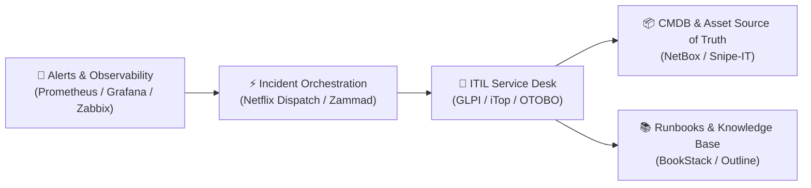

  

      

 

# 🚀 Awesome IT Service Management (ITSM)

**A definitive, curated index of enterprise SaaS platforms and open-source GitHub projects for modern IT Service Management (ITSM), Service Desk operations, CMDB asset management, and ITIL-aligned automation.**

*Updated for 2026 • Curated with ❤️ for IT leaders, SysAdmins, DevOps engineers, and SRE teams.*

---

## 📌 Table of Contents

- [🌐 Sector Overview & Market Dynamics](#-sector-overview--market-dynamics)
- [💼 Enterprise SaaS Platforms](#-enterprise-saas-platforms)
- [🔓 Open-Source GitHub Projects](#-open-source-github-projects)
- [🏗️ Recommended Architectural Stacks](#️-recommended-architectural-stacks)
- [🤝 How to Contribute](#-how-to-contribute)
- [⭐ Star History](#-star-history)
- [⚖️ Disclaimer & Compliance](#️-disclaimer--compliance)
- [💖 Support & Sponsoring](#-support--sponsoring)

---

## 🌐 Sector Overview & Market Dynamics

The global **IT Service Management (ITSM)** market is currently valued between **$14.3 billion and $16.6 billion** (2025–2026), expanding at a robust double-digit compound annual growth rate (CAGR) of **~14% to 16%** toward an estimated **$25+ billion** by 2030, driven by rapid cloud migration, Enterprise Service Management (ESM) expansion, and generative AIOps automation. 

From a competitive standpoint, the ITSM landscape is **moderately fragmented**: an oligopolistic, concentrated top tier—dominated by cloud giants such as ServiceNow, Atlassian, BMC Software, and Salesforce capturing multi-million-dollar global enterprise contracts—coexists alongside an agile, fragmented long tail of mid-market SaaS innovators and self-hosted open-source platforms addressing data sovereignty, rapid deployment, and cost efficiency.

---

## 💼 Enterprise SaaS Platforms

A side-by-side comparison of leading commercial ITSM and Enterprise Service Desk solutions, sorted by **Company Size / Valuation (descending)**.

| 🏢 Platform | 📈 Company Size / Valuation | 💳 Starting Tier Pricing | 🎁 Free Tier / Trial Limits | 🛠️ Core ITIL & ITSM Focus |
| :--- | :--- | :--- | :--- | :--- |
| **[Salesforce IT Service](https://www.salesforce.com/)** | **~$300 Billion** Market Cap *(FY2025 Rev: $34.9B)* | **$25 / user / month** *(Starter Suite, billed annually)* | **30-day free trial** *(Full access, up to 10 users, pre-built workflows, no credit card required)* | ITIL-aligned service catalog, incident lifecycle, and omnichannel service desk integrated natively with Salesforce CRM data. |
| **[ServiceNow ITSM](https://www.servicenow.com/)** | **~$195 Billion** Market Cap *(2024 Rev: $10.99B)* | **~$100 / user / month** *(ITSM Standard base tier; annual contract floor applies)* | **Free Personal Developer Instance (PDI)** *(Full ITSM/CMDB stack; reclaimed after 10 days inactivity) or 15-day enterprise sandbox* | Enterprise market leader; full ITIL v4 processes, Configuration Management Database (CMDB), predictive AIOps, and generative AI Virtual Agent. |
| **[Jira Service Management](https://www.atlassian.com/software/jira/service-management)** | **~$45 Billion** Market Cap *(FY2025 Rev: $4.9B)* | **$17.65 / agent / month** *(Standard tier, billed annually; $22.05/mo monthly)* | **Free forever plan** *(Up to 3 agents, 2 GB file storage, unlimited customer portals, community support)* | Deep integration with Jira Software, Bitbucket, and Confluence; incident swarming, change approval automation, and asset management. |
| **[ManageEngine ServiceDesk Plus](https://www.manageengine.com/)** | **~$15 Billion** Valuation *(Zoho Corp Annual Rev: ~$1.4B+)* | **$10 / technician / month** *(Standard Cloud tier, billed annually; $12/mo monthly)* | **Free forever plan** *(Up to 5 technicians for Standard on-premise/cloud edition) or 30-day full Enterprise trial* | Integrated ITIL service desk covering incident, problem, change management, hardware/software CMDB, IT purchase orders, and contracts. |
| **[BMC Helix ITSM](https://www.bmc.com/)** | **~$8.5 Billion** Valuation *(KKR Owned; Annual Rev: ~$2.0B)* | **~$85 / user / month** *(Helix ITSM named user subscription, annual contract)* | **30-day guided cloud trial** *(Pre-configured ITIL processes, sample CMDB data, and self-service portal)* | Cloud-native cognitive service management platform (formerly Remedy) with containerized deployment, 360° asset tracking, and AIOps automation. |
| **[Freshservice](https://www.freshworks.com/freshservice/)** | **~$4.5 Billion** Market Cap *(2024 Rev: ~$720M)* | **$19 / agent / month** *(Starter tier, billed annually; $29/mo monthly)* | **14-day free trial** *(Pro/Enterprise capabilities, up to 10 agents, Freddy AI Copilot included, no credit card required)* | Intuitive modern service desk featuring Freddy AI ticket summarization, automated asset discovery, release/change tracking, and project management. |
| **[Ivanti Neurons for ITSM](https://www.ivanti.com/)** | **~$4.0 Billion** Valuation *(Clearlake / TA Associates; Rev: ~$1.4B)* | **~$79 / analyst / month** *(Base Neurons ITSM subscription, annual contract)* | **30-day free trial sandbox** *(Includes sample asset databases, automated remediation bots, and self-service catalog)* | Unified Endpoint Management (UEM) convergence with ITSM; hyper-automation self-healing bots, hardware discovery, and ITIL change control. |
| **[SolarWinds Service Desk](https://www.solarwinds.com/)** | **~$2.1 Billion** Market Cap *(Annual Rev: ~$780M)* | **$39 / technician / month** *(Essentials plan, billed annually)* | **30-day free trial** *(Full access to incident management, service catalog, and asset tracking; unlimited technicians)* | Direct integration with SolarWinds network and infrastructure observability suites for real-time alert-to-ticket incident workflows. |
| **[Cherwell Service Management](https://www.cherwell.com/)** | **~$700 Million** Valuation *(Acquired by Ivanti Portfolio)* | **~$75 / concurrent user / month** *(Hosted or on-premises subscription)* | **30-day guided cloud evaluation** *(Pre-built ITIL workflow templates, no-code business process visual designer)* | High-configurability no-code service management platform with visual workflow builders, hardware inventory, and cross-department ESM modules. |
| **[SysAid](https://www.sysAid.com/)** | **~$200 Million** Valuation *(Summit Partners Backed; Rev: ~$50M ARR)* | **~$35 / admin / month** *(Base annual package from $1,211/yr for 3 admins & 500 assets)* | **30-day full-featured trial** *(Includes SysAid Copilot generative AI, automatic asset discovery, and up to 500 managed assets)* | ITSM platform natively incorporating SysAid Copilot AI for automated ticket categorization, self-service resolution, and network asset scanning. |

---

## 🔓 Open-Source GitHub Projects

Explore the most capable open-source ITSM platforms, self-hosted service desks, CMDB tools, and incident response engines. Sorted by **GitHub Star Count (descending)**.

* 🌟 **[Chatwoot](https://github.com/chatwoot/chatwoot)**   
  *License: MIT* • *Stack: Ruby on Rails, Vue.js, PostgreSQL, Redis*  
  Open-source customer engagement and helpdesk suite with an omnichannel shared inbox covering live chat, email, WhatsApp, SMS, and social media. Ideal for IT teams needing rapid conversational user support alongside traditional ticketing.

* 🌟 **[NetBox](https://github.com/netbox-community/netbox)**   
  *License: Apache-2.0* • *Stack: Python, Django, PostgreSQL, Redis*  
  The leading open-source source of truth for network infrastructure, IP address management (IPAM), and data center infrastructure management (DCIM). Serves as an authoritative infrastructure CMDB foundation for enterprise ITSM pipelines.

* 🌟 **[UVdesk](https://github.com/uvdesk/community-skeleton)**   
  *License: MIT* • *Stack: PHP, Symfony, MySQL*  
  Modular, enterprise-grade open-source helpdesk system. Features automated email-to-ticket conversion, role-based workflows, ticket forwarding, configurable workflows, and custom customer portal designs.

* 🌟 **[Snipe-IT](https://github.com/snipe/snipe-it)**   
  *License: AGPL-3.0* • *Stack: PHP, Laravel, MySQL*  
  The industry-standard open-source IT Asset Management (ITAM) software. Tracks hardware assets, software licensing, accessories, consumables, and warranties with QR/barcode scanning and full REST API integration for ITSM CMDBs.

* 🌟 **[Dispatch](https://github.com/Netflix/dispatch)**   
  *License: Apache-2.0* • *Stack: Python, FastAPI, Vue.js, PostgreSQL*  
  Netflix's open-source crisis and incident management orchestration engine. Automates incident response lifecycles by coordinating Slack channels, Google Docs/Jira tickets, Zoom bridges, and post-incident review workflows.

* 🌟 **[GLPI](https://github.com/glpi-project/glpi)**   
  *License: GPL-3.0* • *Stack: PHP, MariaDB/MySQL*  
  The premier open-source enterprise ITSM and CMDB management suite. Bridges ITIL service desk ticketing (incident, problem, change management) with complete asset tracking, network inventory, contract management, and financial budgeting.

* 🌟 **[Zammad](https://github.com/zammad/zammad)**   
  *License: AGPL-3.0* • *Stack: Ruby on Rails, GraphQL, Elasticsearch, PostgreSQL/MySQL*  
  Modern open-source web-based helpdesk and ticketing platform. Features real-time simultaneous collaboration, SLA tracking, multi-channel intake (email, telephone, Telegram, social channels), and Elasticsearch-powered lightning search.

* 🌟 **[FreeScout](https://github.com/freescout-helpdesk/freescout)**   
  *License: AGPL-3.0* • *Stack: PHP, Laravel, MySQL*  
  Lightweight, self-hosted Help Scout alternative designed to run smoothly on budget hardware (1–2 GB RAM). Includes collision detection, conversation threading, canned replies, push notifications, and a rich module marketplace.

* 🌟 **[osTicket](https://github.com/osTicket/osTicket)**   
  *License: GPL-2.0* • *Stack: PHP, MySQL*  
  One of the most battle-tested open-source support ticket systems in existence. Offers email piping, custom form fields, ticket filters, automated department routing, SLA plans, client portal, and ticket lock collision prevention.

* 🌟 **[LibreDesk](https://github.com/abhinavxd/libredesk)**   
  *License: AGPL-3.0* • *Stack: Go, SQLite/PostgreSQL*  
  Modern, ultra-lightweight self-hosted customer support and helpdesk shipped as a single compiled Go binary. Consumes under 512 MB RAM while offering automated routing, SLA controls, CSAT surveys, and AI-assisted responses.

* 🌟 **[Helpy](https://github.com/helpyio/helpy)**   
  *License: MIT* • *Stack: Ruby on Rails, PostgreSQL*  
  Clean, mobile-first open-source customer support platform with multi-channel ticketing, internal knowledge base for IT runbooks, community discussion forums, and multilingual capabilities.

* 🌟 **[Trudesk](https://github.com/polonel/trudesk)**   
  *License: Apache-2.0* • *Stack: Node.js, MongoDB, WebSockets*  
  Real-time open-source help desk and ticketing engine. Built with Node.js and MongoDB, it provides instant live ticket notifications, agent chat, time tracking, custom ticket priorities, and reporting dashboards.

* 🌟 **[iTop](https://github.com/Combodo/iTop)**   
  *License: AGPL-3.0* • *Stack: PHP, MySQL*  
  Full-featured open-source ITIL service management platform built around an extensively customizable CMDB. Provides graphical impact analysis, change advisory board (CAB) workflows, incident management, and automatic data synchronization.

* 🌟 **[Request Tracker (RT)](https://github.com/bestpractical/rt)**   
  *License: GPL-2.0* • *Stack: Perl, PostgreSQL/MySQL*  
  Industrial-strength, battle-tested issue tracking and incident response system trusted by universities, government agencies, and Fortune 500 NOCs worldwide for over two decades. Features limitless workflow customizability and PGP/S-MIME encryption.

* 🌟 **[Znuny](https://github.com/znuny/Znuny)**   
  *License: GPL-3.0* • *Stack: Perl, JavaScript, MariaDB/PostgreSQL*  
  Active community-driven fork of the classic OTRS Community Edition. Delivers enterprise-grade ITIL workflows: incident, problem, and change management, CMDB integration, and SLA escalation tracking designed for large IT departments.

* 🌟 **[REI3](https://github.com/r3-team/r3)**   
  *License: MIT* • *Stack: Go, Vue.js, PostgreSQL*  
  Self-hosted open-source low-code application builder with ready-to-use business management and service request modules. Features flexible workflow automation, clear ticket statuses, and permission controls.

* 🌟 **[OTOBO](https://github.com/RotherOSS/otobo)**   
  *License: GPL-3.0* • *Stack: Perl, Vue.js, MariaDB/MySQL*  
  Modernized fork of OTRS Community Edition with an updated responsive web interface, elastic search engine, ITIL-compliant service catalog, CMDB, and transparent migration tools from legacy OTRS instances.

---

## 🏗️ Recommended Architectural Stacks

Building a fully sovereign, self-hosted enterprise ITSM ecosystem? Combine these open-source tools:

* **Core ITSM & ITIL Compliance**: Deploy **[GLPI](https://github.com/glpi-project/glpi)** or **[iTop](https://github.com/Combodo/iTop)** for complete CMDB, problem, and change management.
* **Customer & User Intake**: Use **[Zammad](https://github.com/zammad/zammad)** or **[Chatwoot](https://github.com/chatwoot/chatwoot)** for responsive, omnichannel ticket intake.
* **Asset & Hardware Lifecycle**: Integrate **[Snipe-IT](https://github.com/snipe/snipe-it)** for physical assets and **[NetBox](https://github.com/netbox-community/netbox)** for network DCIM/IPAM tracking.
* **Incident War-Room Automation**: Leverage **[Netflix Dispatch](https://github.com/Netflix/dispatch)** to coordinate Slack, Zoom, and post-mortem incident documentation.

---

## 🤝 How to Contribute

Contributions from IT managers, developers, and sysadmins are warmly welcomed! 

1. 🍴 **Fork the repository** on GitHub.
2. 🌿 **Create a new branch** (`git checkout -b feature/add-new-itsm-tool`).
3. 📝 **Add or update entries** in `README.md`:
   - Keep descriptions concise, factual, and neutral.
   - For SaaS tools: include starting tier pricing and specific free trial limits.
   - For open-source tools: include official repository link, license, and technical stack.
4. 🚀 **Commit your changes** (`git commit -m "Add ToolName to ITSM list"`).
5. 📬 **Open a Pull Request** with a brief summary of the submission.

---

## ⭐ Star History

---

## ⚖️ Disclaimer & Compliance

* This repository is a community-maintained directory for informational and benchmarking purposes. Listed products are trademarks of their respective owners.
* When selecting an ITSM platform, evaluate alignment with regulatory frameworks (GDPR, HIPAA, SOC 2, ISO 27001) and ITIL v4 practices.
* Self-hosted open-source software requires dedicated infrastructure hardening, backups, reverse proxies, and ongoing maintenance.

---

## 💖 Support & Sponsoring

If this curated IT Service Management repository saved you hours of research or helped you architect your ITIL infrastructure:

* ⭐ **Star this repository** to improve visibility across the GitHub community.
* 🍴 **Fork it and contribute** updates or new open-source discoveries.
* 📢 **Share it** with fellow DevOps engineers, SREs, and IT service managers.
* ☕ **Sponsor**: Support ongoing maintenance and curated tools via the [GitHub Sponsor Dashboard](https://github.com/sponsors/ishandutta2007).

  Maintained by <a href="https://github.com/ishandutta2007">Ishan Dutta</a> and the open-source community.

